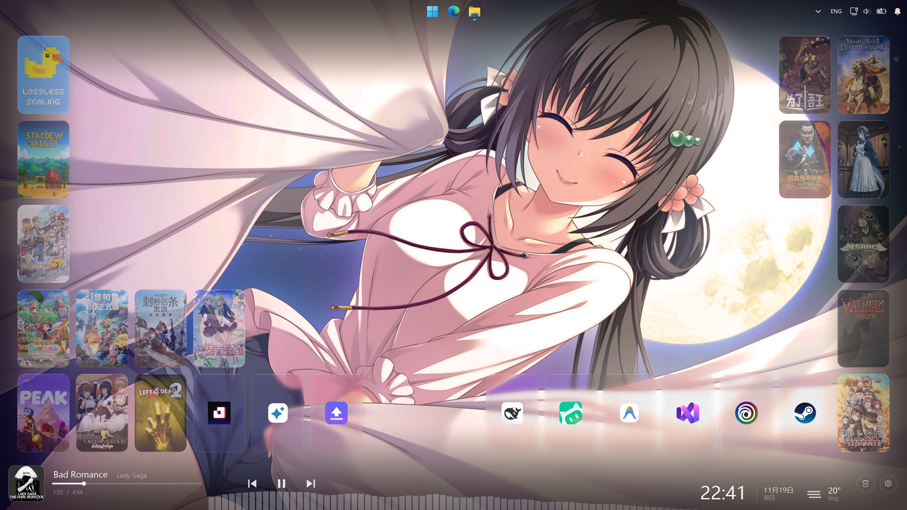
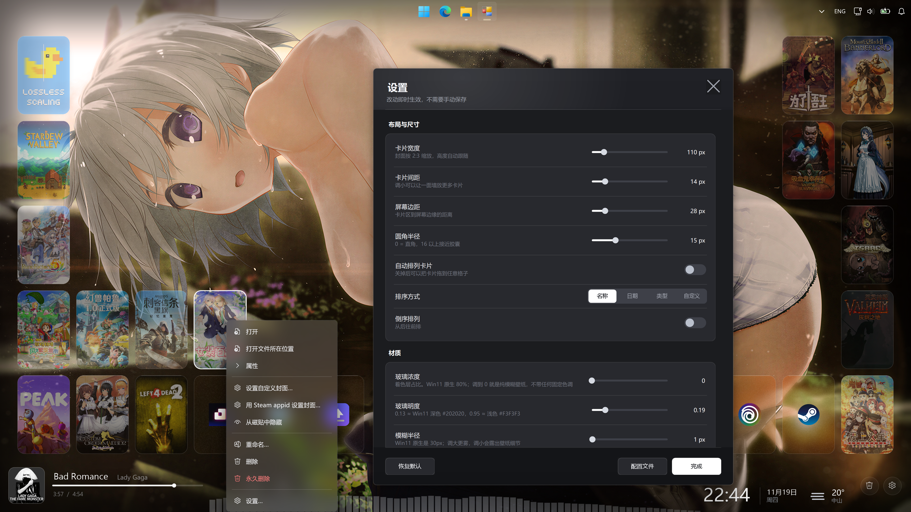

# TileDesk

> 常驻 Windows 桌面层的磁贴墙：以 Steam 库风格的竖版封面渲染桌面快捷方式，单个 exe，无第三方依赖。


---

## 简介

> **100% 肥鱼科技，没有一点人类成分。**

TileDesk 用一块铺满工作区的**逐像素透明分层窗口**替代 Windows 原生桌面图标，把桌面快捷方式渲染成 2:3 竖版封面卡片。卡片之外的区域完全透明，鼠标点击直接穿透到桌面；壁纸原样保留。

渲染模型是「预烘焙位图 + 脏区上传」：每张卡片预先烘焙常态与悬停两张位图，稳态运行时每帧只重绘发生变化的矩形。空闲时帧时钟停摆，CPU 占用趋近于零。

## 特性

**磁贴**

- 封面铺满整张卡片（2:3，与 Steam `library_600x900` 规格一致），圆角 + 发丝描边 + 双层投影
- 无封面的项目使用亚克力玻璃卡：同屏位置的重度模糊壁纸 + 中性深色着色 + 细噪点 + 图标
- 拖拽重排，其余卡片自动让位并记忆落位；支持网格排列与自由排列
- 拖到右下角垃圾桶即删除桌面快捷方式（进回收站，可还原）
- 监视桌面目录，快捷方式增删改名约 1 秒内同步
- Steam 游戏自动匹配官方竖版封面；缺失时按 2:3 裁剪横版 `header.jpg` 兜底
- 右键卡片：打开 / 定位文件 / 属性 / 自定义封面 / 按 Steam appid 设置封面 / 重命名 / 隐藏 / 删除

**视觉与交互**

- 悬停：放大 4.5% + 上浮 + 强调色描边，名称随后淡入；悬停封面按不透明渲染，与半透的常态墙形成对比
- 空闲可配置秒数后整墙淡出
- 右下角常驻齿轮与垃圾桶按钮；齿轮菜单含设置、刷新、重排、重置位置、重载壁纸、图标开关、开机自启、详细日志
- 右键菜单与设置界面均为独立 WPF 窗口，背景走系统亚克力
- 托盘图标提供同一套入口

**系统集成**

- 桌面底层 / 壁纸层两种窗口模式，启动时自动探测可用方案
- 隐藏与恢复原生桌面图标、开机自启、安装与卸载，全部内建于 exe
- 正在播放（SMTC）与音频频谱（WASAPI 环回 + FFT），显示在播放器条窗口
- 时钟与天气，可选玻璃底板
- 磁贴墙、播放器条、时钟为三个独立分层窗口，z 序由磁贴墙统一管理

## 截图



菜单与设置界面：



## 系统要求

| 项 | 要求 |
|---|---|
| 系统 | Windows 10 1809 或更高 / Windows 11 |
| 运行时 | .NET Framework 4.x（系统自带） |
| 安装 | 无需安装，双击即运行 |
| 第三方依赖 | 无 |

## 使用

双击 `TileDesk.exe` 启动。磁贴墙在工作区铺开，右下角按钮与托盘图标是全部入口。

### 操作

| 操作 | 效果 |
|---|---|
| 单击 / 双击卡片 | 打开项目 |
| 拖动卡片 | 重排；被拖卡片跟手浮起，其余卡片自动让位 |
| 拖到垃圾桶 | 删除桌面快捷方式（进回收站） |
| 滚轮 | 上下滚动 |
| `Ctrl` + 滚轮 | 缩放卡片尺寸（保持 2:3，自动保存） |
| 右键卡片 | 项目菜单 |
| 右键空白处 | 桌面自身菜单（空白处点击穿透） |
| 悬停右下角 | 显示齿轮与垃圾桶按钮 |

### 命令行

```powershell
TileDesk.exe --install              # 安装到本机并设置开机自启
TileDesk.exe --uninstall            # 关闭自启 + 恢复原生图标 + 删除安装目录
TileDesk.exe --uninstall --purge    # 连同配置与封面缓存一并删除
TileDesk.exe --windowed             # 置顶预览窗口（自带壁纸底，用于调试与截图）
TileDesk.exe --mode Desktop         # 强制壁纸层模式
TileDesk.exe --mode Bottom          # 强制桌面底层模式
TileDesk.exe --data <dir>           # 指定数据目录
TileDesk.exe --settings             # 启动后直接打开设置界面
TileDesk.exe --multi                # 跳过单实例检查
```

### 环境变量

| 变量 | 作用 |
|---|---|
| `TILEDESK_HOME` | 数据目录 |
| `TILEDESK_VERBOSE=1` | 强制开启详细日志 |
| `TILEDESK_DEMO_HOVER=<序号>` | 令指定序号的卡片保持悬停态 |

## 配置

配置文件为 `%LOCALAPPDATA%\TileDesk\config.json`，日常通过设置界面修改。写入是原子的（先写 `.tmp` 再替换），读取兼容带 BOM 的文件。

| 键 | 默认 | 说明 |
|---|---|---|
| `cardWidth` / `cardHeight` | 115 / 172 | 卡片尺寸（96 DPI 逻辑像素），2:3 与封面规格一致 |
| `gap` | 14 | 卡片间距 |
| `padding` | 28 | 卡片区到屏幕边缘的距离 |
| `cornerRadius` | 10 | 圆角半径 |
| `cardOpacity` | 1.0 | 玻璃材质不透明度（不影响封面） |
| `coverOpacity` | 1.0 | 封面不透明度（不影响玻璃；悬停时不生效） |
| `uiScale` | 0 | `0` 跟随系统 DPI，也可强制 `1` / `1.5` / `2` |
| `showLabels` | false | 常态显示名称 |
| `labelsOnHover` | true | 悬停时浮出名称 |
| `acrylicTintOpacity` | 0.80 | 着色层浓度 |
| `acrylicBrightness` | 0.125 | 材质明度（0.125 ≈ `#202020`） |
| `acrylicSaturation` | 1.5 | 背景饱和度提升 |
| `acrylicBlur` | 30 | 背景模糊半径（逻辑像素） |
| `deskInfoGlass` | false | 时钟是否垫玻璃底板 |
| `shadowOpacity` / `shadowSize` / `shadowColor` | 0.60 / 24 / `#000000` | 投影浓度、扩散半径、颜色 |
| `accentColor` | `#4C9AFF` | 悬停与选中的强调色 |
| `showControlButton` | true | 右下角常驻按钮 |
| `bottomLift` | 16 | 时钟与右下按钮上提距离 |
| `sortMode` / `sortDescending` | `Name` / false | 排序依据与方向 |
| `autoArrange` | false | 开 = 网格顺序即位置，关 = 记忆每张卡的格子 |
| `order` / `positions` | `[]` | 自定义顺序与格子，按文件名持久化 |
| `watchDesktop` | true | 监视桌面目录自动同步 |
| `idleHideSeconds` | 60 | 空闲淡出秒数，0 = 不淡出 |
| `showNowPlaying` | true | 播放器控件 |
| `npWidth` / `npHeight` / `npMargin` | 690 / 84 / 14 | 播放器面板尺寸与边距 |
| `showSpectrum` | true | 音频频谱 |
| `spectrumBars` | 72 | 柱数 |
| `spectrumHeight` / `spectrumWidth` | 65 / 0.54 | 柱高上限与频谱占屏宽比例 |
| `spectrumOpacity` / `spectrumBarWidth` / `spectrumFall` | 0.85 / 0.85 / 0.12 | 不透明度、柱宽比例、下落时间常数 |
| `showDeskInfo` / `weatherCity` / `weatherAnim` | true / `""` / true | 时钟天气与定位、图标动画 |
| `fontFamily` | `Microsoft YaHei UI` | 卡片字体，缺失时自动回退 |
| `downloadSteamArt` | true | 本地无封面时联网补下 |
| `windowMode` | `Bottom` | `Bottom` 桌面底层 / `Desktop` 壁纸层 |
| `verboseLog` | false | 详细日志 |
| `hidden` / `extraFolders` / `exclude` | `[]` | 隐藏列表、额外扫描目录、排除规则 |

## 数据目录

| 内容 | 位置 |
|---|---|
| 配置 | `%LOCALAPPDATA%\TileDesk\config.json` |
| 封面缓存 | `%LOCALAPPDATA%\TileDesk\art\` |
| 自定义封面 | `%LOCALAPPDATA%\TileDesk\covers\` |
| 运行日志（默认不创建） | `%LOCALAPPDATA%\TileDesk\tiledesk.log` |

数据目录按下列顺序取第一个可写项；已在使用的目录（内含 `config.json`）优先，避免切换环境时目录迁移：

1. `--data` 参数
2. `TILEDESK_HOME`
3. `%LOCALAPPDATA%\TileDesk`
4. exe 同级的 `TileDesk-data\`（受限进程或绿色运行时的回退）
5. `%TEMP%\TileDesk`

封面仅在本地缺失时下载一次，之后读缓存。日志超过 1 MB 轮转为 `tiledesk.log.1`。

## 构建

```powershell
cd tiledesk
.\build.ps1
```

- 使用系统自带的编译器（`csc` / Roslyn），源码语言级别为 C# 5
- 产物：`build\TileDesk.exe`、`dist\TileDesk.exe`、`dist\TileDesk-v<版本>.exe`
- 构建脚本校验 `AssemblyFileVersion` 与 `src\Version.cs` 中的 `AppVersion.Text` 一致，不一致则失败
- `build.ps1` 必须保存为 UTF-8 with BOM：Windows PowerShell 5.1 在无 BOM 时按 ANSI 解析脚本，中文注释会导致语法错误

## 目录结构

```
tiledesk/
├─ src/
│  ├─ Program.cs           入口、桌面层级探测、系统集成（图标开关、开机自启、安装卸载）
│  ├─ Engine.cs            帧时钟、分层窗口画布、投影工厂、缓动、帧统计
│  ├─ Material.cs          亚克力材质（模糊、着色、噪点、内描边）
│  ├─ TileForm.cs          磁贴墙：布局、卡片烘焙、脏区、交互、拖拽、频谱绘制
│  ├─ SettingsForm.cs      设置界面
│  ├─ UiKit.cs             自绘控件（滑块、开关、分段选择、按钮、输入框）
│  ├─ WpfMenu.cs           右键菜单（独立 WPF 窗口，系统亚克力背景）
│  ├─ NowPlaying.cs        系统媒体控件（SMTC）读取
│  ├─ NowPlayingWidget.cs  正在播放与频谱条（独立分层窗口）
│  ├─ DeskInfoWindow.cs    时钟与天气（独立分层窗口）
│  ├─ AudioSpectrum.cs     WASAPI 环回采集、FFT、频段合并
│  ├─ AudioMeter.cs        系统音量峰值（备用）
│  ├─ Core.cs              图标提取、Steam 封面解析、壁纸模糊、色彩工具
│  ├─ Config.cs            配置读写与数据目录回退
│  ├─ Native.cs            Win32 / Shell P/Invoke
│  └─ Version.cs           版本号（与 AssemblyInfo.cs 一致）
├─ build.ps1               构建脚本
├─ screenshot.png / screenshot-menu.png
└─ build/ dist/            构建产物（不纳入版本控制）
```

## 实现要点

**窗口层级。** 理想方案是把窗口挂进桌面的 `WorkerW` 壁纸层，但部分系统对跨进程 `SetParent` 返回 `ERROR_ACCESS_DENIED`。程序探测失败后自动切换为桌面底层模式：

1. 窗口铺满工作区而非整屏，任务栏位于任意边都不受影响
2. `SetWindowPos` 把窗口排到 `Progman` 正上方：壁纸之上、所有应用窗口之下
3. `WM_MOUSEACTIVATE` 返回 `MA_NOACTIVATE` + `WS_EX_NOACTIVATE`，点击不会激活自身
4. 拦截 `WM_SYSCOMMAND / SC_MINIMIZE`，`Win+D` 不会最小化磁贴墙
5. `WS_EX_TOOLWINDOW`，不进任务栏与 Alt+Tab
6. 低频校正 z 序（2 秒一次）

**渲染。** 磁贴墙是一个 `WS_EX_LAYERED` 全屏窗口，画面画进 `CreateDIBSection` 位图后按脏区 `UpdateLayeredWindow`。`LayerSurface` 封装「DIB + memDC + Bitmap + Graphics + 上传」，三个分层窗口共用同一套上传路径与非托管暂存区。

**帧时钟。** `CreateWaitableTimerEx(CREATE_WAITABLE_TIMER_HIGH_RESOLUTION)` 在独立线程精确等待，到点只向 UI 线程投递一条消息，不做绘制。空闲时停止等待，不依赖 `timeBeginPeriod`。

**脏区。** 悬停、波纹、启动反馈各自标记自己的矩形；滚动只标记网格条带；结构变化（换壁纸、改尺寸、排序）才整窗重绘。卡片烘焙按时间片摊开，单帧上限 10 ms，不阻塞输入与动画。

**卡片。** 常态与悬停各一张预烘焙位图，含双层投影、描边与辉光。悬停过渡不重画，而是同一卡位的位图替换：底层按 `1−e` 淡出、悬停层按 `e` 淡入，两权重之和恒为 1，因此任何一帧都只有一层封面可见。

**投影。** 两层结构：接触阴影（小半径、偏深、紧贴下沿）给重量，环境阴影（大半径、很淡、四周均匀）给体积。阴影在半分辨率上模糊后放大，计算量为全分辨率的 1/4。

**材质。** 亚克力按 WinUI `AcrylicBrush` 的配比实现：背景模糊 30 px → 饱和度 1.5 → 着色 80% → 噪点 5% → 1 px 内描边。磁贴墙位于桌面层，卡片背后恒为壁纸，因此「预模糊壁纸按位置取样」与系统级实时模糊等价，无需为每张卡单独开窗口。

**频谱。** WASAPI 环回采集默认播放设备的输出，2048 点 FFT（48 kHz 下 23 Hz/bin），按对数频段 40 Hz–16 kHz 合并成柱。平滑分三层：逐 bin 时间平滑、频段内取平均、柱下落曲线，再做两遍横向平滑；静音时不计算。

**DPI。** 进程声明为 system-DPI-aware，配置存放 96 DPI 下的逻辑像素，运行时乘以缩放系数。

## 性能

3840×2160 @200%、35 个桌面项目、默认设置：

| 场景 | 每帧耗时 | 说明 |
|---|---|---|
| 空闲 | 0 帧 | 帧时钟停摆，仅保留 250 ms 逻辑节拍 |
| 悬停动画 | 1.4 – 1.8 ms | 只重绘该卡片所在矩形 |
| 滚动 | 3.3 – 5.0 ms | 只重绘网格条带（约 11 MB 上传） |
| 整窗重绘 | 10.7 ms 绘制 + 12.0 ms 上传 | 仅换壁纸、改尺寸、排序时发生 |
| 首帧 | 8 – 11 ms | 模糊壁纸后台生成 |

内存占用约 152 MB（4K 画布 + 卡片缓存 + 图标 + 封面）。

## 已知限制

- 材质为预模糊壁纸蒙版实现，非系统级实时模糊
- 频谱绘制在播放器条窗口上，被其他窗口完全遮挡时不绘制（遮挡期间自动暂停更新）
- 系统面板（开始菜单、任务栏溢出面板）层级高于本程序
- 壁纸层模式依赖系统允许程序调整窗口层级，被拒绝时回退到桌面底层模式

## 排查

| 现象 | 处理 |
|---|---|
| 需要日志 | 齿轮菜单 →「写详细日志」，日志写入 `%LOCALAPPDATA%\TileDesk\tiledesk.log` |
| 卡片遮挡任务栏或位置异常 | 托盘 →「窗口停在桌面底层」重新选择，或重启程序 |
| 浅色壁纸下卡片发白 | 调低设置中的「亚克力亮度」至 0.4 左右 |
| 个别项目无封面 | 该封面在 Steam CDN 上不存在（未发售 / Demo 常见），卡片回退为图标样式，属预期行为 |
| 临时隐藏磁贴墙 | 托盘 →「隐藏磁贴墙」 |

## 许可

本仓库未附开源许可协议。
